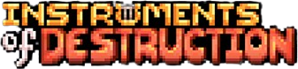
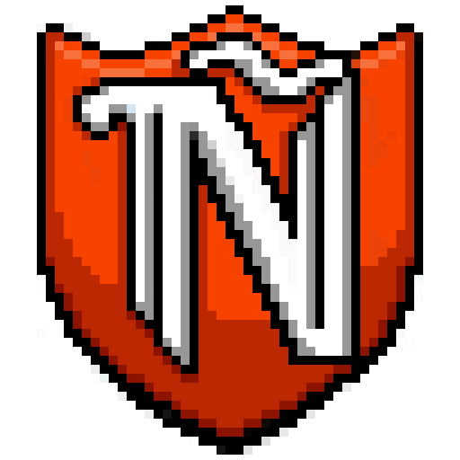
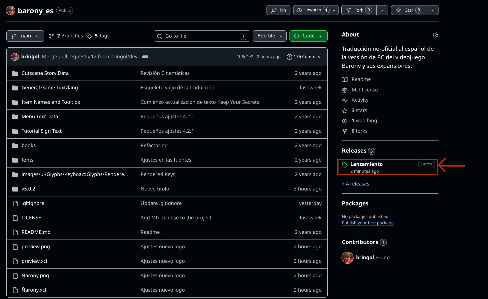
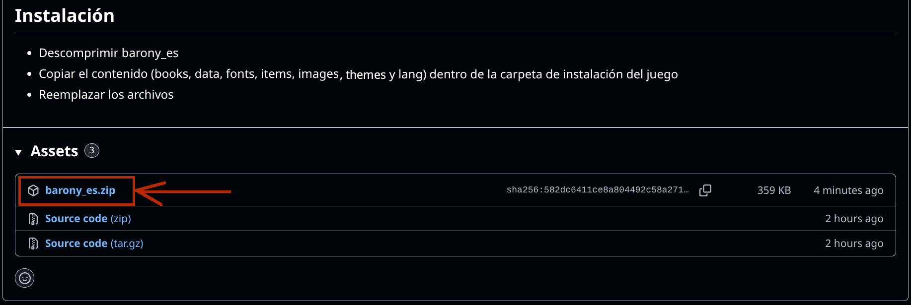

<h1 align="center">Barony en Español</h1>

<p align="center">
  
</p>

**Traducción no oficial** al español del videojuego Barony y sus expansiones - de la compañía Turning Wheel LLC, actualmente disponible para PC en [Steam](https://store.steampowered.com/app/371970/Barony/), [GOG](https://www.gog.com/game/barony_cursed_edition), [EGS](https://www.epicgames.com/store/en-US/p/barony) y [Nintendo Switch](https://www.nintendo.com/us/store/products/barony-switch/).

La traducción ofrece una instalación manual e independiente de Steam para aquellas personas que no tienen acceso a Steam-Workshop.

<br>
<br>
<br>

<div align="center">

# Importante
<p align="center">
  
</p>

</div>
<br>

En caso de encontrar errores/bugs/crashes, por favor, reportarlo en la sección ["Reporte de Errores" del Steam Workshop](https://steamcommunity.com/workshop/filedetails/discussion/2707610137/806849643178746906/), en el canal "Bugs Traducción" del [Discord no oficial Barony en Español](https://discord.gg/3qWzv7gTKK), o desde este mismo repositorio.

<br>
<br>
<br>

---
<br>
<br>

##  Instalación Manual
<p align="center">
    <a></a>
</p>

<p align="center">
        <a></a>
</p>

Cada release trae un zip por versión del juego (`barony_es-5.0.2.zip`, `barony_es-4.3.2.zip`, `barony_es-3.3.7.zip`); descarga el de tu versión. En Steam las versiones anteriores se eligen desde Propiedades → Betas.

## Instalación desde Steam
- [Barony Workshop](https://steamcommunity.com/sharedfiles/filedetails/?id=2707610137)

## Cómo está organizado

La traducción vive en catálogos gettext (`po/<catálogo>/es.po`), uno por tipo de texto: `lang` (`lang/en.txt`), `textos` (los JSON de interfaz, objetos, compendio, historia y tutoriales) y `libros`. Cada texto se identifica por su archivo y su clave (`lang/en.txt:1900`, `lang/item_names.json:/items/bronze_sword/name_identified`) y aparece una sola vez aunque esté en varias versiones del juego; si el inglés cambió entre versiones, aparece una vez por redacción con una nota de las versiones que la usan.

`source/` guarda los archivos en inglés del juego que se traducen: la versión más nueva completa y cada versión anterior solo con lo que difiere de la siguiente (`.removed` lista lo que no tiene). `assets/` guarda igual las fuentes, imágenes y mapas traducidos. `rules.json` dice qué rutas de cada JSON son texto; `layout` son datos que acompañan a la redacción, como las palabras resaltadas en los letreros del tutorial o el interlineado de las descripciones, y se traducen como JSON; `restore` recupera archivos de versiones anteriores, como un libro que el juego eliminó y la traducción conserva. Para dejar vacío un texto a propósito, como un artículo que en español sobra, tradúcelo con un solo espacio.

```bash
# Generar la carpeta traducida de una versión en build/<versión>
python tools/barony_es.py build 5.0.2

# Progreso por versión
python tools/barony_es.py stats

# Tras una actualización del juego: releer el inglés y actualizar los catálogos
python tools/barony_es.py extract --game 5.0.2="RUTA/Barony" --game 4.3.2="RUTA/Barony_4.3.2" --game 3.3.7="RUTA/Barony_3.3.7"

# Importar una carpeta ya traducida con la estructura del juego
python tools/barony_es.py import 5.0.2 RUTA/carpeta_traducida
```

Los catálogos se pueden editar con cualquier editor de PO (Poedit, Weblate, Lokalize). Al publicar un tag `v*`, el workflow genera las tres versiones y sube solo el zip de las que cambiaron respecto al release anterior. `img/preview_workshop.png` es la vista previa del mod en el Workshop.

<br>
<br>
<br>

### Agradecimientos
* _Turning Wheel LLC_, desarrolladores de Barony, por [publicar su código](https://github.com/TurningWheel/Barony) y facilitar la localización del juego mediante la externalización de sus textos.
* Al grupo de discord [_Barony en Español_](https://discord.gg/SqZTwQV) por ofrecer un espacio de encuentro para los jugadores hispanohablantes.
* _LordDestroHD_, _Adrii_, _Hy!Shin_ y _FrankySniper_ por sus traducciones parciales de versiones anteriores de Barony, cuyos contenidos fueron consultados y adaptados selectivamente para este proyecto.
* _reffpixels_ por su tipografía [Pixelart_Serif_Font_v02](https://reffpixels.itch.io/seriffont)
* _Jayvee Enaguas (HarvettFox96)_ por su tipografía [Pixel Operator Mono8-Bold](https://www.dafont.com/pixel-operator.font)
* _memesbruh03_ por su tipografía [Superstar](https://fontmeme.com/fonts/superstar-memesbruh03-font)
* [_suquinho de chorume_](https://steamcommunity.com/sharedfiles/filedetails/?id=2613956785), [_Barony PL_](https://steamcommunity.com/sharedfiles/filedetails/?id=3078243671),  [Tradução Brasileira[PT/BR]](https://steamcommunity.com/sharedfiles/filedetails/?id=3344827761) y [_Barony Italian Translation_](https://github.com/SirZompiGit/Barony_Italian_traslation/tree/main) por servir como referencia para la estructura del proyecto y la resolución de cuestiones lingüísticas


 
